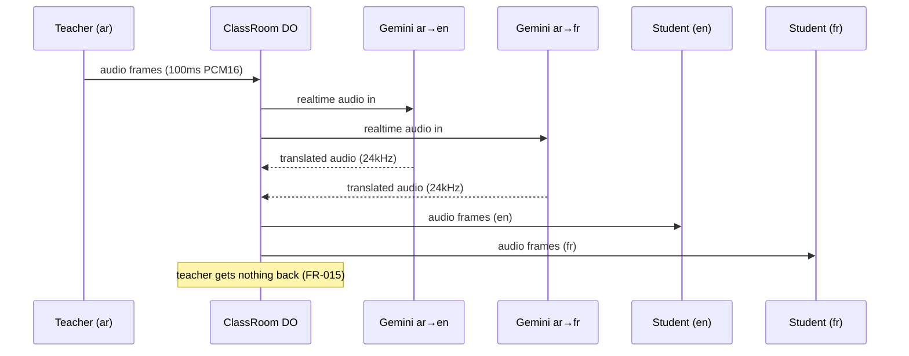
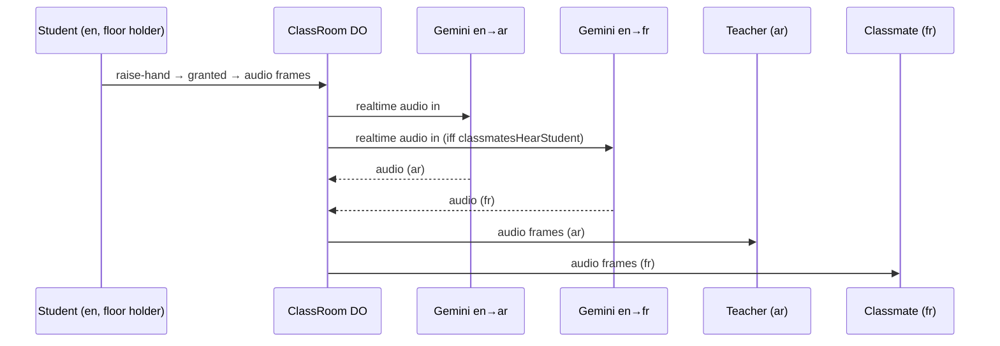

# Fitra — Architecture

Spec-only. All external facts cite the doc URL next to the claim.

## 1. Components

```
┌──────────┐   WSS binary+JSON   ┌──────────────────────┐  WSS (server side)  ┌────────────┐
│ Browser  │ ◄─────────────────► │ ClassRoom Durable    │ ◄─────────────────► │ Gemini Live│
│ React SPA│   audio + control   │ Object (1 per room)  │  translate sessions │ Translate  │
└──────────┘                     └──────────┬───────────┘                     └────────────┘
      ▲                                     │ HTTP/RPC
      │ static assets                       ▼
┌─────┴─────────────────────────────────────┴─────────┐
│ Hono on Workers (join/create/token, serves SPA)     │   D1 + Better Auth: M2+
└─────────────────────────────────────────────────────┘
```

| Component | Responsibility | Notes |
|---|---|---|
| React SPA (Vite+TS+Tailwind, Workers Static Assets) | Capture/playback audio, floor UI, metrics panel, RTL/i18n | Static-asset requests are free/unlimited on Workers Free (source: `https://developers.cloudflare.com/workers/platform/pricing/`) |
| Hono on Workers | `POST /rooms`, `POST /rooms/:code/join` (mints HMAC token), serves SPA, kill switch | Validate BEFORE touching the DO: "Both Workers and Durable Objects are billed based on the number of requests. Validate requests in your Worker" (source: `https://developers.cloudflare.com/durable-objects/best-practices/websockets/`) |
| ClassRoom DO (SQLite-backed) | Floor control, fan-out, TranslationProvider sessions, rate limits | Free plan allows ONLY SQLite-backed DOs (source: `https://developers.cloudflare.com/durable-objects/platform/pricing/`). One instance per room via `idFromName(roomCode)` |
| TranslationProvider | Gemini / Fake behind one interface | Key only in Worker secret; DO opens outbound WSS to Gemini |

## 2. Sequence diagrams

### 2.1 Teacher speaks (ar → en, fr)



### 2.2 Student speaks (en → ar + classmates)



### 2.3 Floor change (preemption + revoke)

```mermaid
sequenceDiagram
    participant S as Student (speaking)
    participant T as Teacher
    participant DO as ClassRoom DO
    participant All as All clients
    T->>DO: speaking-start (or revoke)
    DO->>DO: close/suspend student sessions; state=TEACHER_SPEAKING
    DO->>All: floor-changed {holder: teacher}
    T->>DO: audio… / speaking-stop
    DO->>All: floor-changed {holder: none}
```

### 2.4 Translation session failure

```mermaid
sequenceDiagram
    participant DO as ClassRoom DO
    participant G as Gemini session
    participant All as All clients
    G-->>DO: close/error (or GoAway timeLeft)
    DO->>All: session-status {pair, reconnecting, attempt}
    DO->>DO: backoff (250ms·2ⁿ, ≤5s) → reconnect with resumption handle
    alt resumed
        DO->>All: session-status {pair, live}
    else attempts exhausted
        DO->>All: session-status {pair, failed}; affected listeners muted + notice
    end
```

## 3. Durable Object internals

- **Class**: `ClassRoom`, `new_sqlite_classes` (SQLite backend is mandatory on
  Free; source: pricing URL above). SQLite used ONLY for room config +
  membership + resumption handles — never audio.
- **Routing**: one instance per room via `idFromName(roomCode)`, so the room code
  in `state.id.name` is the room identity and the DO is authoritative for
  membership (SPEC FR-004, FR-050).
- **Schema** (T-006): `room_config` (single row: code, `created_at_ms`,
  `next_index`, `next_session`, `teacher_lang`, `expired_at_ms`) and
  `membership` (`participant_id` PK, `participant_index` UNIQUE, `session`,
  `role`, `name`, `lang`). Writes happen only on join and leave — admission,
  index allocation and roster rendering are the only SQL in the hot path, and a
  re-sent roster is a `SELECT`, not a write (AGENTS.md rule 2).
- **Admission** is measured against LIVE sockets (`getWebSockets()` +
  `deserializeAttachment()`), so a stale membership row can never lock a seat;
  the roster itself is rendered from SQLite so it survives hibernation. Rejected
  joins (second teacher, room full, expired room) complete the handshake, receive
  one `error` frame and close, and never become hibernating members.
- **Rejoin**: `session` is a monotonic per-join counter. A participant opening a
  second socket keeps their index and takes over; the replaced socket's late
  `webSocketClose` is a no-op because it no longer owns the membership row.
- **Cleanup**: no `setInterval`. A single alarm is scheduled for the earlier of
  the room-duration deadline (`MAX_ROOM_MINUTES`, default 120) and the idle
  deadline (15 min after the last participant leaves, FR-052). Firing it while
  the room is empty marks it expired, so the DO can hibernate/evict and the dead
  room code cannot be reused.
- **Client sockets**: Hibernation WebSocket API (`acceptWebSocket`,
  `webSocketMessage`) for browser connections — hibernation avoids duration
  charges when idle (source: `https://developers.cloudflare.com/durable-objects/best-practices/websockets/`).
- **Critical constraint**: the DO also holds OUTBOUND WebSockets to Gemini.
  "Hibernation is only supported when a Durable Object acts as a WebSocket
  server. Outgoing WebSockets do not hibernate" and "an open outbound
  WebSocket connection prevents eviction for up to 15 minutes" (same source;
  also `.../durable-objects/concepts/durable-object-lifecycle/`). → While any
  translation session is open, the DO is billed for full wall-clock duration
  (see `docs/LIMITS.md` budget). Mitigations: idle-close sessions after 60 s,
  idle-room shutdown, no `setInterval` (use `alarm()` for timeouts — alarms
  prevent hibernation too, so schedule sparsely).
- **No concurrent streaming subrequests in one DO**: one Gemini WS per
  language pair, sequential reconnects; avoids the reported unexpected
  outbound-WS closures (see OQ-05) and the 6-simultaneous-outgoing-connections
  limit (source: `https://developers.cloudflare.com/durable-objects/platform/limits/`).
- **CPU**: forward bytes without parsing payload; JSON control only. DO CPU
  per event default 30 s (same source).

## 4. TranslationProvider interface

```ts
// Lives in worker/src/translation/provider.ts (M0 task). Gemini and Fake
// implement it; room code depends only on this.
export type Lang = string; // BCP-47, validated against config allowlist

export interface TranslationSessionEvents {
  onAudio: (pcm24kMono: ArrayBuffer) => void;   // 24kHz PCM16LE mono chunks
  onTranscript?: (kind: "input" | "output", text: string) => void; // only if API yields them
  onStatus: (s: "connecting" | "live" | "reconnecting" | "failed", detail?: string) => void;
  onGoAway?: (timeLeftMs: number) => void;
}

export interface TranslationSession {
  readonly sourceLang: Lang;
  readonly targetLang: Lang;
  sendInputAudio(pcm16kMono: ArrayBuffer): void; // 16kHz PCM16LE mono, ~100ms
  endInput(): void;   // speaker paused; keep session warm until idle timeout
  close(): void;
}

export interface TranslationProvider {
  readonly name: "gemini-live-translate" | "fake";
  openSession(sourceLang: Lang, targetLang: Lang, ev: TranslationSessionEvents): Promise<TranslationSession>;
  closeAll(): Promise<void>;
}
```

- **SessionManager** (pure logic, unit-tested): `key = src→tgt`, lazy open,
  refcount by listener set, idle-close (default 60 s), cap
  `maxTranslationSessions` (default 8). Overflow policy: protect teacher-leg
  sessions, then earliest-created; overflowed listeners receive
  `session-degraded` + muted translated track (FR-024).
- **Gemini provider** (documented parameters; wire details to verify in OQ-01):
  model `gemini-3.5-live-translate-preview`; setup carries
  `responseModalities: ["AUDIO"]`,
  `translationConfig: { targetLanguageCode, echoTargetLanguage: false }`
  (echo=false so same-language input stays silent; our same-language case
  never opens a session anyway), optional
  `inputAudioTranscription/outputAudioTranscription` for captions,
  `sessionResumption` (tokens valid 2 h after termination per
  `https://ai.google.dev/gemini-api/docs/live-api/session-management`) and
  `contextWindowCompression` (audio-only cap 15 min / connection ~10 min
  without them; same source). In 16 kHz PCM16LE mono 100 ms chunks; out
  24 kHz PCM16LE mono (source:
  `https://ai.google.dev/gemini-api/docs/live-api/live-translate`).
- **Fake provider**: echoes input audio tagged per language (e.g. prepends a
  marker tone / delays), configurable `delayMs`, failure injection
  (`failAfter`, `dropRate`) for tests. Default in dev/test.

## 5. Wrangler bindings & environment

```jsonc
// wrangler.jsonc (M0): exact keys fixed here
{
  "name": "fitra-lab",
  "main": "worker/src/index.ts",
  "assets": { "directory": "web/dist" },
  "durable_objects": { "bindings": [{ "name": "CLASSROOM", "class_name": "ClassRoom" }] },
  "migrations": [{ "tag": "v1", "new_sqlite_classes": ["ClassRoom"] }],
  "vars": {
    "SUPPORTED_LANGUAGES": ["ar", "en", "fr", "es"],
    "MAX_STUDENTS": 30, "MAX_TRANSLATION_SESSIONS": 8,
    "SESSION_IDLE_CLOSE_S": 60, "MAX_ROOM_MINUTES": 120,
    "AUTO_GRANT": false, "CLASSMATES_HEAR_STUDENT": true,
    "ROOM_CREATION_DISABLED": false
  }
}
// secrets (wrangler secret put): GEMINI_API_KEY, JOIN_TOKEN_HMAC_SECRET
// D1 + Better Auth bindings: M2 only. NOT in M0.
```

## 6. Key decisions (why)

1. **Half duplex** — quality + cost (one stream, ≤3 sessions), not a media
   limitation.
2. **DO-side Gemini fan-in/fan-out** — key never in browser; one uplink stream
   serves all listeners of a language; matches free-tier billing (outgoing WS
   messages free).
3. **100 ms binary frames** — Gemini's recommended chunk; ~10 inbound msg/s =
   ~0.5 billed req/s at 20:1; DO does zero audio parsing.
4. **Provider interface + Fake first** — quota-free dev/CI; engine swap later.
5. **Hibernation API for browsers, no hibernation while translating** —
   accepted cost, budgeted in `docs/LIMITS.md`; idle-close bounds it.

## 7. Browser capture pipeline (T-010)

```
getUserStream(mono, 16 kHz ideal, EC/NS/AGC on, exact deviceId)
  → AudioContext({ sampleRate: 16 000, latencyHint: "interactive" })
  → MediaStreamAudioSourceNode
  → AudioWorkletNode("fitra-capture")            web/public/worklets/capture.worklet.js
  → { type: "frame", pcm: ArrayBuffer } ×10/s    (100 ms = 1 600 samples = 3 200 B)
  → AudioFrameSender → encodeAudioFrame(type 0x01) → ws.send(binary)
```

| Concern | Decision |
|---|---|
| Worklet location | `web/public/worklets/`, loaded with `audioWorklet.addModule("/worklets/capture.worklet.js")`. Separate module graph: never in the Vite bundle, never minified, fetched once and cached. |
| Render quantum | Never assumed (128 is common, not guaranteed): the processor only counts samples and emits a frame every 1 600 of them. |
| Scaling | clamp to [-1, 1] **then** × 32767 (32768 wraps to -32768 = full-scale click); non-finite samples become 0 so one NaN cannot poison a 100 ms chunk. |
| Sample rate | Context requested at 16 kHz; if the browser refuses, the worklet runs a linear-interpolating decimator with a phase accumulator carried across `process()` calls. Wire format is 16 kHz either way. |
| Backpressure | Frame **dropped** (never queued) while `ws.bufferedAmount` > 64 KiB (~2 s of stall at 10 frames/s); queueing would only add latency. `framesSent` / `framesDropped` feed the T-012 metrics panel. |
| Speaker index | Assigned by the server `welcome` (`participantIndex`), pushed in with `setSpeakerIndex()` — the client never picks its own index. |
| Playback | The mic is never connected to `ctx.destination`; capture has no output node at all. Playback lives in `web/src/audio/playback.ts` (T-011). |
| Devices | `enumerateDevices()` **after** permission (labels/ids are empty before it); exact `deviceId` match; `devicechange` on the active input falls back to the default one and reports `mic-device-lost`; `getSettings()` verifies EC/NS/AGC actually applied. |
| Test seam | `?injectAudio=1` skips the microphone and feeds synthetic 16 kHz PCM to the sender, publishing `window.__fitraCapture` counters — E2E never depends on Chromium fake-audio flags (OQ-10, T-016). |

Pure helpers (`framePack`, `downsampleLinear`, sender framing) live in
`web/src/audio/capture.ts` and are unit-tested in
`web/tests/audio-pure.test.ts`; the worklet mirrors the same clamp/scale math
because it cannot import the TypeScript module graph.
