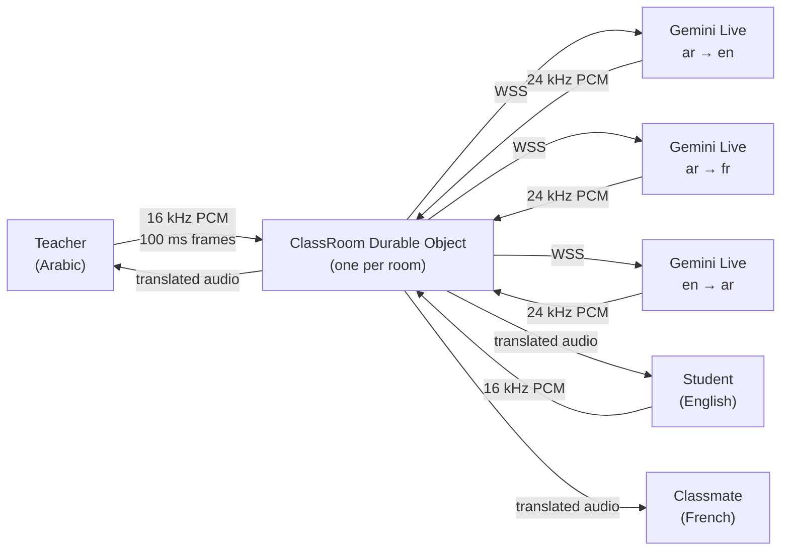

<div align="center">

# فطرة · Fitra

### Real-time speech-to-speech translation for multilingual classrooms

**A teacher speaks Arabic. Every student hears it in their own language — live.**

[](https://www.typescriptlang.org/)
[](https://react.dev/)
[](https://workers.cloudflare.com/)
[](https://developers.cloudflare.com/durable-objects/)
[](https://vitest.dev/)
[](https://playwright.dev/)

**Status:** M0 / M0.6 complete — the Translation Lab runs end to end on the Cloudflare free tier.

</div>

---

## What is Fitra?

Fitra is a **live multilingual classroom** built around one core idea: language
should never be the reason a student cannot learn from a great teacher.

A teacher creates a room and shares a code. Students join from any browser with
no account, pick the language they speak, and immediately hear the lesson in
their own language. When a student speaks, the teacher hears them in the
teacher's language — and classmates can hear them too.

It is not a meeting app with a translation plugin bolted on. Translation is the
product, and the entire stack — audio capture, transport, session routing, mic
moderation, and UI — is designed around low-latency, simultaneous, multi-speaker
voice translation.

> **Current languages:** Arabic, English, French, Spanish (`ar`, `en`, `fr`, `es`).
> The language list is server-configured and extensible.

---

## Highlights

- **True speech-to-speech** — the teacher speaks naturally; students hear
  synthesized translated audio, not subtitles to read.
- **Simultaneous speakers** — multiple open mics run through independent
  translation pipes. Two people can talk at once and neither stream is mixed or
  lost.
- **Zoom/Meet-style moderation** — the teacher can force-mute one student or
  everyone; students unmute themselves. Mic state is **server-authoritative**,
  so a client cannot bypass a mute.
- **Live captions** — optional input/translated transcript in a chat-style
  timeline, with correct Arabic RTL rendering.
- **Same-language passthrough** — listeners who already speak the source
  language get the original audio untouched: zero AI cost, zero latency.
- **Built for the free tier** — SQLite-backed Durable Objects, hibernating
  WebSockets, static assets on Workers, and no per-chunk persistence.
- **Observable by default** — an in-app panel shows end-to-end latency, live
  sessions, reconnect counts, message rates, and Durable Object active time.
- **Private by design** — no recording, no audio persisted; transcripts are
  memory-only in the current milestone.

---

## How it works



1. **Capture** — an `AudioWorklet` records mono 16-bit PCM at 16 kHz and emits
   100 ms frames with a custom 8-byte binary header.
2. **Transport** — frames travel over a single WebSocket to the room's
   `ClassRoom` Durable Object; control messages are JSON on the same socket.
3. **Route** — the DO keys each translation pipe by
   `(speaker → source language → target language)`, shares a pipe across all
   listeners who need it, and reference-counts it.
4. **Translate** — the DO opens a server-side WSS connection to Gemini Live
   Translate. The API key never reaches the browser.
5. **Play** — translated 24 kHz PCM is demultiplexed per speaker and scheduled
   through a jitter-buffered `AudioBufferSourceNode` pipeline for smooth
   playback.

The `TranslationProvider` interface isolates the AI engine. Tests and local
development use a deterministic `FakeTranslationProvider`, so the whole system
runs with **zero Gemini quota**.

---

## Tech stack

| Layer | Technology |
|---|---|
| Frontend | React 18, TypeScript (strict), Vite, Tailwind CSS |
| Internationalization | RTL-first UI, Arabic-first copy, `ar` / `en` / `fr` / `es` |
| Audio | Web Audio API, `AudioWorklet`, PCM16, jitter buffering |
| Transport | Plain WebSocket (binary audio + JSON control) |
| API | Hono on Cloudflare Workers |
| Room state | `ClassRoom` Durable Object (SQLite-backed, WebSocket Hibernation) |
| AI translation | Google Gemini Live Translate (`gemini-3.5-live-translate-preview`), server-side only |
| Auth | HMAC-SHA256 short-lived join tokens (Better Auth planned for M2) |
| Protocol | `@fitra/shared` — binary codec, message types, runtime guards |
| Testing | Vitest (unit + Workers pool), Playwright (multi-tab E2E), k6 (planned) |
| Tooling | pnpm workspace, Wrangler, strict TypeScript |

---

## Quick start

### Prerequisites

- **Node.js 20+**
- **pnpm 10+** (`corepack enable` is the easiest way)
- A Cloudflare account only when you deploy

### Install

```bash
git clone <your-repo-url> Fitra
cd Fitra
pnpm install
```

### Run locally (no API key, no quota)

Create a `.dev.vars` file in the repo root — it is gitignored:

```ini
JOIN_TOKEN_HMAC_SECRET=dev-only-change-me
TRANSLATION_PROVIDER=fake
```

Then build the SPA and start the Worker, Durable Object, and static assets from
one origin:

```bash
pnpm dev:worker
```

Open **http://localhost:8787**, create a room, and join from two or three
browser tabs. The fake provider echoes audio back so you can exercise the full
flow without spending Gemini credits.

> Use headphones when testing with real microphones to avoid echo.

### Run with real Gemini translation

```bash
# Store the key as a Worker secret — never in client code or .dev.vars committed to git.
pnpm exec wrangler secret put GEMINI_API_KEY

# The default provider is already `gemini` in wrangler.jsonc.
pnpm build
pnpm exec wrangler dev
```

The Gemini free tier is suitable for development and testing only — see
[`docs/PRIVACY.md`](docs/PRIVACY.md). Production requires a paid tier.

---

## Commands

| Command | What it does |
|---|---|
| `pnpm dev` | Vite dev server for the SPA |
| `pnpm dev:worker` | Build the SPA, then run Worker + DO + assets with the fake provider |
| `pnpm build` | Build all workspace packages |
| `pnpm test` | Run unit and Durable Object tests across the workspace |
| `pnpm typecheck` | Strict `tsc` across every package |
| `pnpm e2e` | Build, install Chromium if needed, and run the Playwright acceptance suite |

The E2E suite runs three browser contexts (teacher in Arabic, students in English
and French) through the complete acceptance flow against the fake provider — no
secrets, no outbound network, no Gemini calls.

---

## Configuration

Runtime configuration lives in [`wrangler.jsonc`](wrangler.jsonc) and can be
overridden per environment.

| Variable | Default | Purpose |
|---|---|---|
| `TRANSLATION_PROVIDER` | `gemini` | `gemini` or `fake` (local dev and E2E use `fake`) |
| `SUPPORTED_LANGUAGES` | `["ar","en","fr","es"]` | BCP-47 languages accepted at join |
| `MAX_STUDENTS` | `30` | Students per room |
| `MAX_TRANSLATION_SESSIONS` | `8` | Concurrent AI pipes per room before graceful degradation |
| `SESSION_IDLE_CLOSE_S` | `60` | Close an unused translation session after this idle time |
| `MAX_ROOM_MINUTES` | `120` | Hard room lifetime |
| `CLASSMATES_HEAR_STUDENT` | `true` | Whether classmates hear other students translated |
| `ROOM_CREATION_DISABLED` | `false` | Global kill switch for new rooms |
| `JOIN_TOKEN_HMAC_SECRET` | — | **Secret.** Signs short-lived join tokens |
| `GEMINI_API_KEY` | — | **Secret.** Used only inside the Durable Object |

---

## Project structure

```text
Fitra/
├── web/                      # React SPA: screens, audio pipeline, captions, metrics
│   ├── src/
│   │   ├── screens/          # Create, Join, Room
│   │   ├── audio/            # capture, playback, devices, latency, room shell
│   │   ├── components/       # MicBar, Roster, MetricsPanel, ConsentModal
│   │   ├── net/              # HTTP API + WebSocket client
│   │   └── captions.ts       # Pure caption/transcript reducer
│   └── tests/                # Vitest unit tests
├── worker/                   # Hono API + ClassRoom Durable Object
│   └── src/
│       ├── index.ts          # Rooms, join tokens, static assets, kill switch
│       ├── room.ts           # ClassRoom DO: membership, mic, fan-out, metrics
│       ├── mic.ts            # Mic-policy state machine
│       ├── metrics.ts        # Latency, rates, session snapshots
│       ├── resample.ts       # 16 kHz ↔ 24 kHz helpers
│       ├── auth/token.ts     # HMAC join tokens
│       └── translation/      # provider.ts, gemini.ts, fake.ts, sessions.ts
├── packages/shared/          # Binary protocol codec, types, runtime guards
├── e2e/                      # Playwright multi-tab acceptance suite
├── docs/                     # Protocol, limits, mic control, privacy, test plan
├── scripts/                  # Gemini and production probe utilities
├── ARCHITECTURE.md           # Component design and sequence diagrams
├── SPEC.md                   # Normative functional requirements
├── TASKS.md                  # Milestones and task breakdown
└── wrangler.jsonc            # Worker, DO, assets, and runtime configuration
```

---

## Documentation

| Document | Contents |
|---|---|
| [`SPEC.md`](SPEC.md) | Product specification, personas, numbered functional requirements |
| [`ARCHITECTURE.md`](ARCHITECTURE.md) | Component design, sequence diagrams, Durable Object internals |
| [`docs/PROTOCOL.md`](docs/PROTOCOL.md) | Wire protocol: binary frames, control messages, upgrade flow |
| [`docs/MIC-CONTROL.md`](docs/MIC-CONTROL.md) | Server-authoritative mic model and edge cases |
| [`docs/LIMITS.md`](docs/LIMITS.md) | Free-tier budgets, frame sizes, billing ratios, capacity math |
| [`docs/TEST-PLAN.md`](docs/TEST-PLAN.md) | Definition of done and test strategy |
| [`docs/PRIVACY.md`](docs/PRIVACY.md) | Consent, retention, and key-handling rules |
| [`docs/OPEN-QUESTIONS.md`](docs/OPEN-QUESTIONS.md) | Assumptions awaiting measurement |
| [`TASKS.md`](TASKS.md) | Milestones and independently testable tasks |

---

## Roadmap

- [x] **M0 — Translation Lab:** rooms, HMAC join tokens, server-authoritative
  mic control, Gemini + fake providers, audio pipeline, metrics, RTL Arabic UI.
- [x] **M0.6 — Translation you can trust:** live server metrics, chat-style
  captions, session resumption, mic-off tails, simultaneous-speaker pipes.
- [ ] **M1 — Multi-language & resilience:** 3+ languages at scale, reconnect
  under forced restarts, rate-limit abuse tests, 30-student k6 fan-out.
- [ ] **M2 — Accounts & courses:** Better Auth, D1 schema, course-bound rooms,
  D1 quota-safe access patterns.
- [ ] **M3 — Learning features:** batched session summaries, glossary and
  terminology controls, teacher dashboard.

---

## Design principles

- **Server-authoritative state.** The Durable Object is the single source of
  truth for membership and mic control; clients send hints, never commands.
- **No audio in the database.** Audio and captions stay in memory. SQLite holds
  only room configuration, membership, and the force-mute latch.
- **Fail visibly.** Session caps, provider errors, and reconnects surface in the
  UI and metrics panel — never as silent audio loss.
- **Swap the engine, not the app.** `TranslationProvider` keeps Gemini behind a
  seam so a future STT → MT → TTS pipeline can replace it without touching room,
  mic, or audio code.
- **Docs ship with code.** Protocol and behavior changes update the relevant
  document in the same task.

---

<div align="center">

**Fitra** — *فطرة* — the disposition to learn, without the language barrier.

</div>
